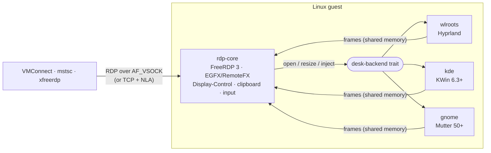

<div align="center">

# wayrdp

**Enhanced Session for Wayland Linux guests on Hyper-V.**
Open VMConnect, pick a resolution, and get your real Wayland desktop at the size of the window.


[What it does](#what-it-does) · [Backends](#backends) · [VMCreate](#wayrdp-in-vmcreate) · [Install](#install) · [Configure](#configure) · [Build](#build)

</div>

---

## Why

Hyper-V's Enhanced Session (VMConnect with resizable windows, clipboard and proper input) was
built for Windows guests. Linux guests got it through **xrdp**, which needs an **X11** desktop
and runs a *separate* login session next to the real one. Modern desktops are Wayland-first:
GNOME 50 ships no X11 session at all, and Plasma 6 defaults to Wayland. xrdp can't serve them.

**wayrdp** is an RDP server that speaks Wayland natively. It doesn't start a second desktop.
It attaches to the session that's already logged in, gives it a virtual screen at your
VMConnect window's size, and streams that screen.

## What it does

- 🖥️ **Your real session, not a copy.** It attaches to the logged-in desktop. Apps, windows and
  state are the ones on the console.
- 📐 **A screen that fits the window.** Each connection gets its own virtual monitor at the
  client's size. Resizing the window resizes the monitor (Display-Control), and the client's
  display scale carries over.
- 🔌 **VMConnect over VMBus.** It listens on AF_VSOCK (Hyper-V sockets), so Enhanced Session
  works with no guest network and no firewall rule. TCP is optional, requires NLA, and binds
  loopback unless you widen it.
- 🎞️ **EGFX + RemoteFX.** Frames go out over the RDP graphics pipeline, with back-pressure that
  survives clients that stop acknowledging frames. Older clients get a SurfaceBits fallback.
- ⌨️ **Input that just works.** Keyboard and pointer go in through the compositor's own virtual
  input (libei/EIS on KDE and GNOME, virtual pointer and keyboard on Hyprland), using real
  scancode translation.
- 📋 **Clipboard both ways.** Text and files, on Hyprland and KDE.
- 🧠 **No GPU needed.** Hyper-V guests render with software GL. wayrdp copies finished frames out
  of **shared memory** (no DMA-BUF), then encodes on the CPU.
- 🛟 **Leaves the console usable.** While you're connected only the virtual screen is on; when
  you disconnect, the physical one comes back. That also holds after a crash, which is checked
  at the next start.

## How it works



The RDP side (`rdp-core`, on FreeRDP 3) doesn't know which compositor it's talking to. Each
desktop gets a **backend** behind one small trait (`desk-backend`): create a virtual screen at a
size, resize it, capture it, and inject input. Backends are picked automatically from
`XDG_CURRENT_DESKTOP`.

## Backends

| Desktop | Backend | Virtual screen | Capture | Input | Clipboard | Tested on |
|---|---|---|---|---|---|---|
| **Hyprland** | `wlroots` | headless output (`hyprctl`) | `ext-image-copy-capture`, or the `hyprland-capture` plugin | virtual pointer + keyboard, client keymap | ✓ | Omarchy (Arch) |
| **KDE Plasma 6.3+** | `kde` | KWin virtual output ([`hyperv-rdp-extras`](https://github.com/moerketh/hyperv-rdp-extras)) | PipeWire, shared memory | KWin EIS, no consent prompt | ✓ | Kali (Plasma 6.7), Parrot (6.3) |
| **GNOME 50+** | `gnome` | Mutter virtual monitor (RemoteDesktop/ScreenCast D-Bus API) | PipeWire, shared memory | Mutter EIS, no consent prompt | not yet | Kali (GNOME 50.5) |
| *(anything else)* | `synthetic` | test pattern | – | – | – | CI and debugging |

Sway and other wlroots compositors are not served: the `wlroots` backend drives Hyprland only.
On those desktops wayrdp refuses to start, so you get an error instead of a test pattern.

## wayrdp in VMCreate

[**VMCreate**](https://github.com/moerketh/VMCreate) creates Kali, Parrot, Omarchy and other Linux
VMs on Hyper-V in one click. Part of the job is giving every VM a working Enhanced Session, and
wayrdp is the server it installs for Wayland desktops it has validated:

| Guest | RDP backend VMCreate's **Auto** picks |
|---|---|
| Kali / Parrot with **KDE Plasma 6.3+** | **wayrdp** (`kde`) |
| Kali with **GNOME 50+** | **wayrdp** (`gnome`) |
| **Omarchy** (Hyprland) | wayrdp (`wlroots`) when chosen |
| Other Wayland desktops | Lamco RDP Server |
| X11-only desktops (Xfce, …) | xrdp |

VMCreate does the guest-side setup wayrdp expects:
- installs the pinned, checksum-verified release tarball and its FreeRDP 3 runtime libraries;
- loads `hv_sock` and enables the systemd user unit with autologin, so the listener is up while
  Hyper-V checks for it (Hyper-V only marks Enhanced Session available if it finds a listener
  early);
- turns off the idle lock screen;
- seeds NLA credentials for TCP.

Open the VM in VMConnect, and the Enhanced Session resolution dialog appears.

## Install

**Through VMCreate:** pick a supported guest and leave the RDP backend on *Auto*.

**By hand:** download the release tarball (or `.deb`), then run its `install.sh`. That installs
`/usr/local/bin/wayrdp` and a systemd **user** unit:

```sh
tar xf wayrdp-<version>-linux-x86_64.tar.gz && cd wayrdp-<version>-linux-x86_64
sudo ./install.sh
systemctl --user enable --now wayrdp
```

Runtime needs: FreeRDP 3 server libraries (`libfreerdp-server3-3`), `libpipewire-0.3` for KDE
and GNOME, and `hv_sock` loaded for VMConnect.

> [!IMPORTANT]
> **Installing after the VM was created?** Hyper-V only marks Enhanced Session available if it
> finds a listener on vsock 3389 early on, and a guest reboot doesn't make it check again. Power
> the VM off and start it again (`Stop-VM`, then `Start-VM`) once wayrdp is enabled.

> [!NOTE]
> **Disable the lock screen** on guests you reach over RDP. GNOME refuses remote-desktop
> sessions while locked, and the lock screen isn't streamed on KDE yet. VMCreate does this for
> you.

## Configure

Configuration is through environment variables on the user unit (for example
`systemctl --user edit wayrdp`).

<details>
<summary><b>Backend selection</b></summary>

- `WAYRDP_BACKEND=wlroots|kde|gnome|synthetic`. When unset, the backend is auto-detected from
  `XDG_CURRENT_DESKTOP` (Hyprland, KDE/plasma, GNOME/`ubuntu:GNOME`).
- These are configuration errors and exit with status **42**, which the unit's
  `RestartPreventExitStatus` uses to stop the retry loop: an unknown value, Sway, KWin older
  than 6.3, missing KDE tools, GNOME older than 50, or GNOME on X11. A desktop that isn't up yet
  exits 1 and is retried.
- `WAYRDP_GNOME_ALLOW_UNTESTED=1` runs the GNOME backend on GNOME older than the oldest tested
  release. GNOME newer than the newest tested release only gets a warning.
- `WAYRDP_KDE_RESTORE_ON_START=0` skips re-enabling physical outputs a crashed run left off.
- `WAYRDP_KDE_RESTART_SHELL=auto|always|never` restarts plasmashell once after the screen swap.
  `auto` does this on KWin 6.7+.
- `WAYRDP_CAPTURE=shm-plugin` captures through the Hyprland plugin
  ([`plugins/hyprland-capture/`](plugins/hyprland-capture/)). It must be built **on the guest**
  against its exact Hyprland headers.

</details>

<details>
<summary><b>Transports and security</b></summary>

- **AF_VSOCK** (on by default; `WAYRDP_VSOCK=0` turns it off) carries VMConnect Enhanced Session
  over VMBus. Peers are limited by the Hyper-V host proxy and by the `WAYRDP_VSOCK_ALLOW` CID
  allowlist. This transport uses the legacy RDP security layer, matching VMConnect's
  no-encryption vsock mode.
- **TCP** (opt-in with `WAYRDP_TCP=1`; port `WAYRDP_PORT`, default 3389) binds loopback unless
  `WAYRDP_BIND=<ip>` widens it. It is **NLA only**: TLS-only clients are refused with
  `HYBRID_REQUIRED`, and startup fails closed with no credentials. Provision them like this:

  ```sh
  read -s pw && winpr-hash3 -u wayrdp -p "$pw" -f sam > ~/.local/share/wayrdp/SAM && unset pw && chmod 600 ~/.local/share/wayrdp/SAM
  ```

  Some distros name the tool `winpr-hash`.
- The TLS certificate and key are generated once under `$XDG_DATA_HOME/wayrdp`, and they
  persist so client trust survives restarts.

</details>

<details>
<summary><b>Tuning and diagnostics</b></summary>

| Variable | Effect |
|---|---|
| `WAYRDP_OUTPUT_HZ` | headless output refresh rate (30–240, default 60) |
| `WAYRDP_ACTIVATION_TIMEOUT_MS` | how long a peer may stay before activation (default 30000) |
| `WAYRDP_DOWNLOAD_BUDGET_MB` | byte budget for one file paste from client to guest (default 2048) |
| `WAYRDP_TILED_DIFF` | region/tile diffs instead of full-surface RFX |
| `WAYRDP_TRACE`, `WAYRDP_TRACE_MARKER` | per-peer frame pipeline trace, motion-to-photon timing |
| `WAYRDP_DEBUG_INPUT` / `_POINTER` / `_CAPTURE` / `_GFX` / `_CURSOR` | focused debug logging |
| `WAYRDP_DUMP_GFX=<dir>` | dump outbound frames for offline analysis |
| `WAYRDP_POINTER_METADATA`, `WAYRDP_CLIENT_CURSOR` | client-drawn cursor experiments (off by default) |

</details>

## Build

Builds run on Linux; WSL works. You need FreeRDP 3 development headers (`freerdp3-dev`;
pkg-config `freerdp-server3 freerdp3 winpr3`), clang for bindgen, and the Wayland, xkbcommon
and PipeWire development libraries.

```sh
cargo build --release -p wayrdp      # -> target/release/wayrdp
cargo test --workspace
scripts/build-package.sh             # -> dist/release/ (tar.gz, .deb, SHA256SUMS.txt)
```

Without the FreeRDP headers, the workspace still type-checks: `freerdp-sys` builds as an empty
stub and the server refuses to start. So a green `cargo check` on Windows says nothing about the
real server. Pushing a `v<version>` tag publishes a GitHub Release through
`.github/workflows/release.yml`.

<details>
<summary><b>Repository layout</b></summary>

| Path | What |
|---|---|
| `crates/freerdp-sys` | bindgen + C shim over FreeRDP 3 |
| `crates/rdp-core` | the RDP server: listener, per-peer state machine, EGFX/RemoteFX, Display-Control, clipboard, input, vsock |
| `crates/desk-backend` | the backend trait (no Wayland dependencies), plus shared resize rules |
| `crates/backend-wlroots` | Hyprland backend |
| `crates/backend-kde` | KDE backend, a thin adapter over `hyperv-rdp-extras` |
| `crates/backend-gnome` | GNOME backend: Mutter session, layout guard, preflight |
| `crates/capture-pipewire` | PipeWire shared-memory capture + desktop health sampling (KDE, GNOME) |
| `crates/input-eis` | libei/EIS input injection (KDE, GNOME) |
| `crates/clipboard-wayland` | clipboard over `ext_data_control_v1` / `zwlr_data_control_v1` |
| `server` | the `wayrdp` binary |
| `plugins/hyprland-capture` | Hyprland capture plugin (C++) |
| `tools/` | VMConnect harnesses and prober, hvsocket forwarder, stress tools |
| `packaging/` | systemd user unit, desktop file, Arch PKGBUILD |

</details>

## Validation

Unit tests cover pure logic. The real gate is a set of **self-asserting VMConnect harnesses**,
run from the Windows host against live guests. They drive the real VMConnect wire path
(AF_HYPERV → raw MCS Connect-Initial, through `tools/vmconnect-probe.cs`) and check the guest
over SSH:

| Harness | Desktop | Checks |
|---|---|---|
| `tools/vmconnect-harness.ps1` | Hyprland | activation, capture liveness, frame flow and content, compositor health, restart churn, mid-activation teardown |
| `tools/vmconnect-harness-kde.ps1` | KDE Plasma | virtual output + layout guard, first frame, rendered desktop, EIS devices, outputs restored, reconnect churn, KWin pid stable |
| `tools/vmconnect-harness-gnome.ps1` | GNOME | Mutter virtual monitor + layout guard, first frame, rendered desktop, EIS mapped to the stream, console restored, reconnect churn, gnome-shell pid stable |

The manual matrix covers mstsc, VMConnect Enhanced Session, and `xfreerdp3 /dynamic-resolution`
(through `tools/vsfwd.cs`, a TCP↔AF_HYPERV forwarder).

## Roadmap and limitations

- **Codec:** RemoteFX only for now. H.264 will come from FreeRDP's OpenH264 backend. x264 (GPL)
  never links into wayrdp, and FFmpeg is not part of the default build.
- **GNOME:** clipboard is next. Ubuntu 24.04 (GNOME 46) and Debian are not validated yet.
- **Lock screens** are not streamed: disable them on RDP guests.
- **Keyboard layout:** on KDE and GNOME, keys follow the guest's layout. Set it to match the
  client. Hyprland compiles the client's layout.
- **Cursor:** the cursor is drawn into the video; client-drawn cursor relay is experimental.
- **mstsc live resize** is unconfirmed; mstsc picks up a new size on reconnect.

## License

MIT. wayrdp links FreeRDP 3 (Apache-2.0). The KDE backend uses
[`hyperv-rdp-extras`](https://github.com/moerketh/hyperv-rdp-extras) as an external library.
